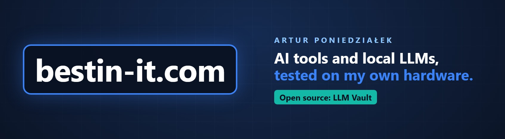

### Hi, I'm Artur 👋

I write [bestin-it.com](https://bestin-it.com) - hands-on articles about AI tools, local LLMs and developer security.
Everything I publish runs on my own machine first (Windows 11 · AMD Radeon PRO W7900), with real numbers and real recordings.

### What I'm building

🔐 **[LLM Vault](https://github.com/bestin-it/llm-vault)** - AI agents use your models, never your API keys.
A free, open-source KeePass-compatible password manager with a built-in LLM gateway. Each agent, IDE or script gets
a scoped token (allowed models, budget, approval), the provider key stays in the encrypted vault.
Works with Claude Code, GitHub Copilot, Ollama, LM Studio, llama.cpp, vLLM and 30+ providers.

[**⬇ Download for Windows**](https://bestin-it.com/llm-vault/) · [Source code](https://github.com/bestin-it/llm-vault) · [Why I built it](https://bestin-it.com/ai-agent-api-key-security/) · [▶ 90-second video](https://youtu.be/WYxzj_zIJUs)

### Worth reading

- [AI agent API key security: let agents use models without seeing the key](https://bestin-it.com/ai-agent-api-key-security/)
- [VS Code Copilot custom endpoint: route Copilot Chat through your own models](https://bestin-it.com/vscode-copilot-custom-endpoint/)
- [One local LLM gateway for Ollama, LM Studio and llama.cpp - measured](https://bestin-it.com/local-llm-gateway-ollama-lm-studio-llama-cpp/)
- [A KeePass-compatible password manager in Rust](https://bestin-it.com/keepass-compatible-password-manager-rust/)

More: [Local AI & LLMs](https://bestin-it.com/category/ai/) · [AI Tools & Automation](https://bestin-it.com/category/ai-tools/) · [Software Development & Tools](https://bestin-it.com/category/tools/)

### Find me

[bestin-it.com](https://bestin-it.com) · [YouTube @bestin-it](https://www.youtube.com/@bestin-it) · [X @bestin_it](https://twitter.com/bestin_it) · [LinkedIn](https://www.linkedin.com/in/artur-poniedzia%C5%82ek-73897297)
